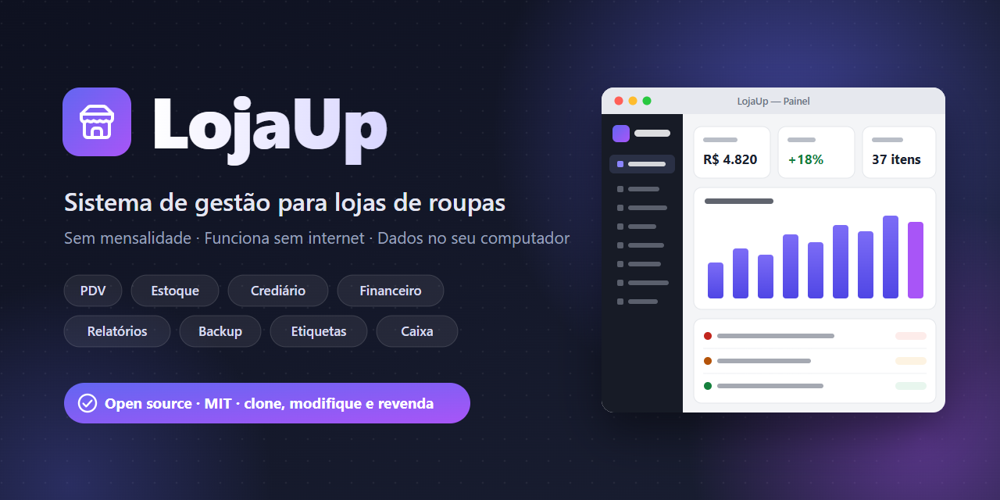

<p align="center">
  
</p>

<p align="center">
  <a href="LICENSE"></a>
  <a href="https://github.com/pixel444-dev/LojaUp/releases/latest"></a>
  
</p>

<p align="center">
  
  
  
  
</p>

<p align="center">
  <b>Sistema desktop para Windows, sem mensalidade e sem internet.</b><br>
  Instala na máquina da loja e roda para sempre — os dados ficam no próprio computador.
</p>

<p align="center">
  <a href="#-módulos">Módulos</a> ·
  <a href="#-download">Download</a> ·
  <a href="#-desenvolvimento">Desenvolvimento</a> ·
  <a href="#-instalando-no-cliente">Instalação no cliente</a> ·
  <a href="#-open-source--pode-revender">Open source</a>
</p>

---

## 💜 Open source — pode revender

O **LojaUp é 100% open source**, sob a [licença MIT](LICENSE). Isso quer dizer que **qualquer pessoa pode**:

| | |
|---|---|
| ✅ **Usar** | na sua loja ou na de clientes, sem pagar nada |
| ✅ **Clonar** | baixar o código-fonte completo |
| ✅ **Modificar** | mudar telas, regras, cores, nome, o que quiser |
| ✅ **Revender** | vender o sistema (original ou modificado) e cobrar por instalação, suporte ou mensalidade |
| ✅ **Distribuir** | compartilhar cópias, com ou sem alterações |

A única condição é manter o aviso de licença (o arquivo [`LICENSE`](LICENSE)) junto com o código. O software é fornecido “como está”, sem garantia.

> Este repositório é mantido por [@pixel444-dev](https://github.com/pixel444-dev): qualquer pessoa pode ver, clonar e fazer *fork*, e sugestões são bem-vindas via *issues* e *pull requests*.

---

## 🧩 Módulos

| Módulo | O que faz |
|---|---|
| 📊 **Painel do dono** | Resumo do dia/mês, projeção do mês, lucro e uma lista automática de alertas: contas atrasadas, crediário vencido, itens que vão acabar, dinheiro parado em encalhados, grade de tamanhos desequilibrada, perdas de estoque, diferenças de caixa, queda de faturamento, excesso de desconto, aniversariantes, clientes sumidos, backup atrasado. |
| 🛒 **PDV (frente de caixa)** | Leitor de código de barras, busca por nome/cor/tamanho, `3*código` para quantidade, promoções automáticas, desconto por item ou na venda, pagamento dividido (dinheiro, Pix, débito, crédito parcelado, crediário, vale-troca), troco, cupom na impressora térmica. Atalhos: <kbd>F2</kbd> buscar, <kbd>F4</kbd> cliente, <kbd>F6</kbd> desconto, <kbd>F10</kbd> finalizar, <kbd>Esc</kbd> cancelar. |
| 💵 **Caixa** | Abertura com fundo de troco, sangria, suprimento, fechamento com conferência (esperado × contado), relatório impresso e histórico de diferenças. |
| 🔁 **Vendas e trocas** | Histórico, reimpressão, cancelamento (devolve estoque e estorna), trocas e devoluções com vale-troca, dinheiro, estorno ou abatimento no crediário. |
| 👕 **Produtos** | Cor, tamanho, marca, modelo, categoria; grade cor × tamanho gerada automaticamente; código de barras interno (EAN-13) quando a peça não tem; etiquetas com código de barras (folha A4 ou impressora de etiquetas); margem e markup. |
| 📦 **Estoque** | Estoque por variação, alerta de estoque baixo, entradas/saídas/ajustes com motivo, inventário com leitor de código de barras, histórico completo e auditoria de diferenças/perdas. |
| 🚚 **Compras e fornecedores** | Cadastro de fornecedores, compras com frete e despesas rateadas no custo, custo médio automático, contas a pagar geradas (à vista ou parcelado), comparação de preços entre fornecedores. |
| 💰 **Financeiro** | Contas a pagar (fixas/variáveis, recorrentes) e a receber, fluxo de caixa realizado + previsto, DRE simplificado (lucro bruto e líquido) e ponto de equilíbrio. |
| 🤝 **Clientes e crediário** | Cadastro, histórico de compras, preferências, limite de crédito, parcelas, juros e multa por atraso, recebimento com recibo, carnê, cobrança pelo WhatsApp, análise de inadimplência (aging) e nota de pontualidade do cliente. |
| 📈 **Relatórios** | Faturamento diário/semanal/mensal, lucro por produto, curva ABC, encalhados com sugestão de desconto, sugestão de compra pelo ritmo de vendas, grade de tamanhos (vendas × estoque), vendas por categoria/marca/tamanho/cor/vendedor/pagamento/dia/horário, valor do estoque. |
| ☁️ **Backup** | Automático ao fechar o sistema e a cada X horas, para o **OneDrive**, **pendrive** (qualquer pendrive conectado) e/ou outra pasta, mantendo os últimos N. Restauração com cópia de segurança. |

**Usuários:** **Administrador** (acesso total) e **Vendedor** (PDV, caixa, vendas, produtos, estoque, clientes — sem custos, financeiro e relatórios). Desconto acima do limite e crediário fora das regras pedem a senha do administrador.

---

## 📥 Download

Baixe o instalador **`LojaUp Setup.exe`** na página de [**Releases**](https://github.com/pixel444-dev/LojaUp/releases/latest). Basta copiar para a máquina da loja (pode ser por pendrive) e instalar — não precisa de internet nem de Node.js.

> O Windows pode mostrar o aviso “O Windows protegeu o computador”, porque o instalador não tem assinatura digital paga. Clique em **Mais informações → Executar assim mesmo**.

---

## 🔧 Desenvolvimento

Requisitos: [Node.js](https://nodejs.org) 20 ou superior.

```bash
git clone https://github.com/pixel444-dev/LojaUp.git
```

```bash
cd LojaUp
```

```bash
npm install
```

```bash
npm run dev
```

Abre o app com recarregamento automático das telas (<kbd>F12</kbd> abre o DevTools). Em desenvolvimento os dados ficam em `%APPDATA%\LojaUp-dev`, separados da instalação real. Alterações em `electron/` exigem reiniciar o comando.

### Gerar o instalador

```bash
npm run dist
```

O instalador fica em `release/LojaUp Setup 1.0.0.exe`.

### Estrutura do código

```
electron/          processo principal (Node)
  main.js          janela, IPC, impressão, backup agendado
  db.js            conexão SQLite e migrações
  api/             regras de negócio (auth, products, sales, customers, purchases, finance, reports, backup)
src/               interface React
  pages/           telas
  components/      componentes compartilhados
  lib/print.js     modelos de cupom, recibo, carnê, vale-troca, fechamento de caixa e etiquetas
```

Para evoluir o banco, adicione uma nova entrada no array `MIGRATIONS` em `electron/db.js` (nunca altere as anteriores) — a atualização é aplicada automaticamente quando o cliente abre a nova versão, sem perder dados.

---

## 🏪 Instalando no cliente

1. Rode o instalador e abra o LojaUp pelo atalho da área de trabalho.
2. No primeiro uso, informe o nome da loja e crie o usuário administrador.
3. **Configurações → Dados da loja**: CNPJ, endereço e telefone (saem no cupom).
4. **Configurações → Impressora**: instale antes o driver Windows da térmica (Elgin, Bematech, Epson, Daruma…), selecione-a, escolha 80 ou 58 mm e marque “imprimir sem perguntar”. Use “Imprimir teste”.
5. **Configurações → Backup**: clique em “Usar OneDrive” (o OneDrive precisa estar instalado e logado) e em “Pendrive”. Clique em “Fazer backup em todos os destinos” para testar.
6. **Configurações → Usuários**: crie os vendedores.
7. Leitor de código de barras: qualquer leitor USB que funcione como teclado (padrão de fábrica) já funciona no PDV, no inventário e nas compras.

### Onde ficam os dados

| O quê | Onde |
|---|---|
| Banco de dados | `%APPDATA%\LojaUp\dados\loja.db` |
| Cópias locais automáticas | `%APPDATA%\LojaUp\dados\backups` |
| OneDrive | `OneDrive\Backup LojaUp` |
| Pendrive | pasta `Backup LojaUp` na raiz do pendrive |

Para levar o sistema para outro computador: instale o LojaUp no novo computador, vá em **Configurações → Backup → Restaurar backup → Escolher arquivo…** e selecione o último backup.

---

## 🧾 Observação fiscal

O cupom impresso é **não fiscal**. Para emissão de NFC-e/NF-e é necessário integrar um emissor homologado (com certificado digital da loja) — o sistema já guarda todos os dados de venda necessários para isso.

---

## 📄 Licença

Distribuído sob a **licença MIT** — veja [`LICENSE`](LICENSE). Use, modifique e revenda à vontade. 💜
